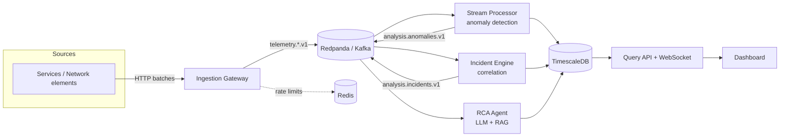

# Argus

**AI-powered incident intelligence for distributed systems.**

Argus ingests telemetry (metrics, logs and change events) from your services and network elements. It detects anomalies in real time and correlates them into incidents. An LLM agent then investigates each incident and proposes a root cause, citing the evidence and your team's runbooks.

[](https://github.com/vedant0496/argus/actions/workflows/ci.yml)


> **Status:** under active development. See the [roadmap](docs/roadmap.md) for the sprint plan.

## Why

On-call engineers lose most of an incident to *triage*: which of the 40 firing alerts matter, what changed, and where to look first. Argus automates that loop:

1. **Detect.** Streaming detectors learn each time series' baseline and flag deviations within seconds.
2. **Correlate.** Anomalies across services, hosts and deploy events are grouped into a single incident.
3. **Explain.** An agent queries metrics, logs, recent changes and runbooks, then writes a ranked root-cause hypothesis with evidence.

## Architecture



Details in [docs/architecture.md](docs/architecture.md). Key decisions are recorded as [ADRs](docs/adr).

| Service | Responsibility | Tech |
|---|---|---|
| `ingestion` | Authenticated, rate-limited batch intake; schema validation; publish to stream | FastAPI, aiokafka, Redis |
| `processor` | Per-series online baselines; anomaly scoring | asyncio, aiokafka |
| `incidents` | Time/topology-window correlation; incident lifecycle | asyncio, TimescaleDB |
| `rca-agent` | Tool-using LLM agent; RAG over runbooks | FastAPI, pgvector, pluggable LLM providers |
| `api` | Query API and live incident feed | FastAPI, WebSockets |
| `web` | Operator dashboard | Next.js (Sprint 5) |

## Quick start

Prerequisites: Python 3.12, [uv](https://docs.astral.sh/uv/), Docker.

```bash
make install     # create the workspace venv and install pre-commit hooks
make check       # lint, typecheck and test
make infra       # start Redpanda, TimescaleDB and Redis
make up          # build and run every service
```

| URL | What |
|---|---|
| http://localhost:8001/docs | Ingestion API |
| http://localhost:8000/docs | Query API |
| http://localhost:8080 | Redpanda Console |

## Repository layout

```
libs/common/        shared config, logging, event schemas, messaging abstractions
services/<name>/    one deployable per directory, each with its own tests
deploy/             infra bootstrap (topics, later Helm charts)
docs/               architecture, roadmap, ADRs
```

## Contributing

See [CONTRIBUTING.md](CONTRIBUTING.md) for the branching model and conventions.

## License

[MIT](LICENSE)
