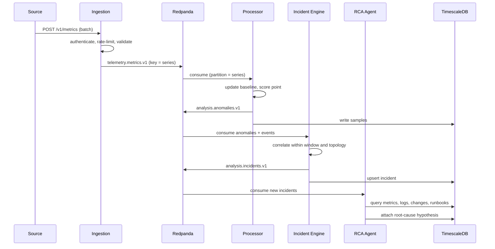

# Architecture

## Goals

- **Horizontal scale on every hop.** Stateless HTTP services scale behind a load balancer. Stream workers scale with topic partitions.
- **Loose coupling.** Services only share versioned event schemas (`argus_common.schemas`) and topic names (`argus_common.topics`), never databases.
- **Replayability.** Every derived artefact (anomalies, incidents) can be rebuilt by replaying the telemetry topics.
- **Testability.** Infrastructure sits behind small protocols (`Publisher`, later `Consumer`, `Repository`), so unit tests run in milliseconds without Docker.

## Data flow

## Topics

| Topic | Key | Partitions | Retention | Producer → Consumer |
|---|---|---|---|---|
| `telemetry.metrics.v1` | series key | 12 | 3d | ingestion → processor |
| `telemetry.logs.v1` | service | 12 | 3d | ingestion → (sink, rca-agent) |
| `telemetry.events.v1` | service | 6 | 7d | ingestion → incidents, rca-agent |
| `analysis.anomalies.v1` | service | 6 | 14d | processor → incidents |
| `analysis.incidents.v1` | incident id | 3 | 30d | incidents → rca-agent, api |
| `system.dead-letter.v1` | origin topic | 3 | 14d | any → ops |

Metric points are keyed by series, so one partition owns each series and the processor can keep that series' baseline in memory without coordination.

## Scaling model

| Component | State | Scales by |
|---|---|---|
| ingestion | none (rate-limit counters in Redis) | replicas behind LB |
| processor | per-series baselines, rebuilt from the topic on rebalance | partitions / consumer group members |
| incidents | open-incident windows (backed by DB) | partitions keyed by tenant/service |
| rca-agent | none | replicas; LLM concurrency limit per tenant |
| api | none | replicas |

## Multi-tenancy

Every schema carries `tenant_id`. The ingestion gateway derives it from the API key and never trusts the payload. Rate limits, storage queries and agent budgets are all scoped per tenant.
